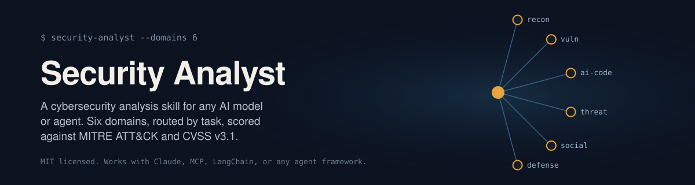

# Security Analyst Skill

[](LICENSE)
[](SKILL.md)
[](SKILL.md)

*If a badge above doesn't render, your network or browser is blocking `img.shields.io` — a common ad-blocker default, not a problem with the repo. Everything else on this page is unaffected.*

A structured cybersecurity analysis skill for any AI model or agent. It gives an agent a methodology instead of just an opinion — six domains, each one grounded in how that work actually gets done in practice, with routing logic that decides which domain applies before any analysis starts.

## Why This Exists

Most AI agents asked a security question jump straight to an answer, skipping the part where a real analyst figures out what kind of problem they're even looking at first. This skill forces that step. Reconnaissance data gets read differently from a crash dump. A phishing email gets read differently from a SQL injection. And code written by another AI tool gets a review pass built for the specific ways that code tends to fail — a growing blind spot as more production code starts out as an AI-generated first draft.

## The Six Domains

| # | Domain | Catches | Reference file |
| :--- | :--- | :--- | :--- |
| 0 | **Reconnaissance & OSINT** | Attack surface buried in Nmap/Shodan/Sublist3r output, exposed infra, leaked org intel | `references/reconnaissance.md` |
| 1 | **Vulnerability & Exploit Logic** | Memory corruption, injection, broken access control, and exploitability triage straight from a crash dump or assembly snippet | `references/vulnerability-analysis.md` |
| 1b | **AI-Generated Code Review** | Hallucinated packages (slopsquatting), omitted security controls, overly permissive defaults — failure modes specific to AI-written code | `references/ai-generated-code.md` |
| 2 | **Threat & Binary Analysis** | Malware classification, persistence and C2 behavior, with output as ready-to-use YARA rules and STIX-style IOC records | `references/threat-analysis.md` |
| 3 | **Human & Attack Vectors** | Phishing, vishing, pretexting, BEC — read by the psychological lever being pulled, not just the surface red flags | `references/social-engineering.md` |
| 4 | **Defense & Countermeasures** | Patch prioritization, breach remediation, and an OPSEC/data-handling review for privacy-sensitive apps | `references/remediation.md` |

Every finding that maps to a real vulnerability or observed behavior gets tagged against **MITRE ATT&CK** and scored with a **CVSS v3.1** estimate, so the output reads like something a security team can actually act on, not a generic writeup. Every reference file closes with worked examples in an input → analysis → output shape, so an agent using this skill sees exactly what the expected depth and tone look like, not just a list of rules to paraphrase.

## Usage

Works with anything that supports the general idea of "skills" or tool/function calling.

**Claude** — drop the whole `security-analyst/` folder into the skills directory for the project or account.

**Any other agent framework** — LangChain, Semantic Kernel, MCP, or a direct integration — use the tool definition in `SKILL.md` under "Tool Definition," and feed the `references/` files in as context or system instructions.

## What a Response Actually Looks Like

A short excerpt from `references/vulnerability-analysis.md`, showing the expected shape:

> **Input**: A login endpoint builds its query as `"SELECT * FROM users WHERE username = '" + user_input + "'"` and passes it straight to the database.
>
> **Output**: Vulnerability: SQL injection in the login query through the unsanitized `username` field. Fix: swap the string concatenation for a parameterized query... Classification: CWE-89, ATT&CK T1190 (Exploit Public-Facing Application). CVSS v3.1 read: network, low complexity, no privileges or user interaction needed, high confidentiality and integrity impact. **Critical.**

## File Structure

```
security-analyst/
├── SKILL.md                          # Overview, routing logic, classification standards, tool definition
└── references/
    ├── reconnaissance.md             # OSINT and attack-surface mapping (Nmap/Shodan/Sublist3r)
    ├── vulnerability-analysis.md     # Code vulnerabilities, exploit logic, crash/assembly triage
    ├── ai-generated-code.md          # Review patterns specific to AI-written/AI-assisted code
    ├── threat-analysis.md            # Suspicious file/behavior analysis, forensics, YARA/IOC output
    ├── social-engineering.md         # Social engineering and phishing assessment
    └── remediation.md                # Patching, defense, operational security, OPSEC data-handling review
```

## Scope

Built to support a security decision: reviewing code, classifying a threat, spotting social engineering, planning remediation. It is not a tool for generating ready-to-use exploits or malware, and it says no to that explicitly rather than quietly complying — the boundaries are laid out in `SKILL.md` and apply no matter how a request is framed.

## License

MIT License, see `LICENSE`.
